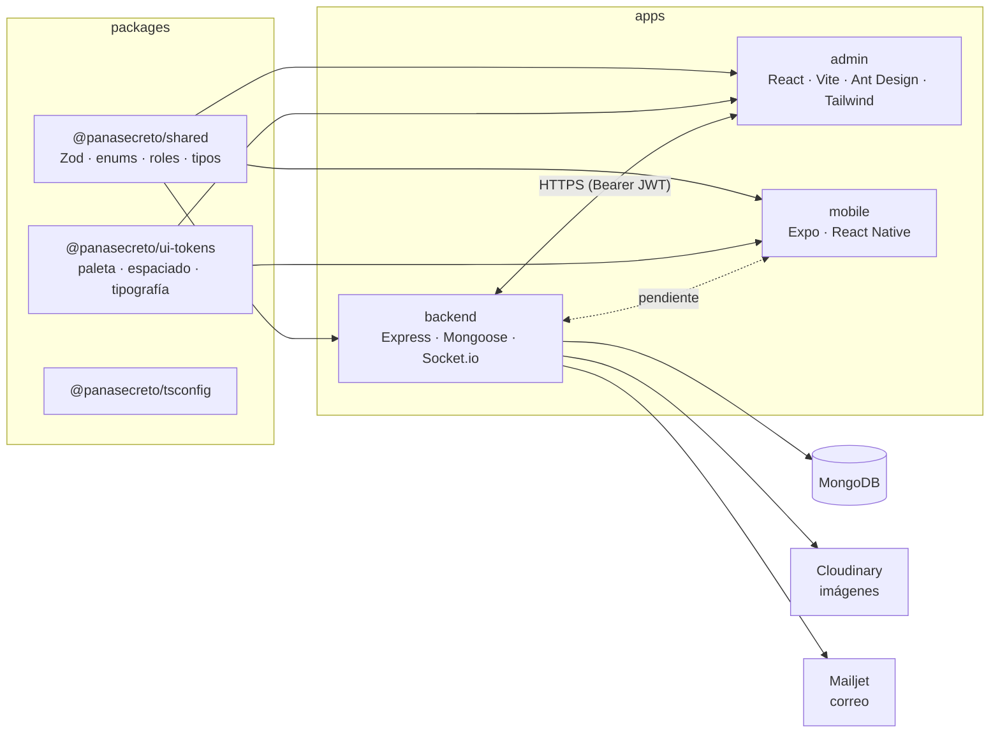
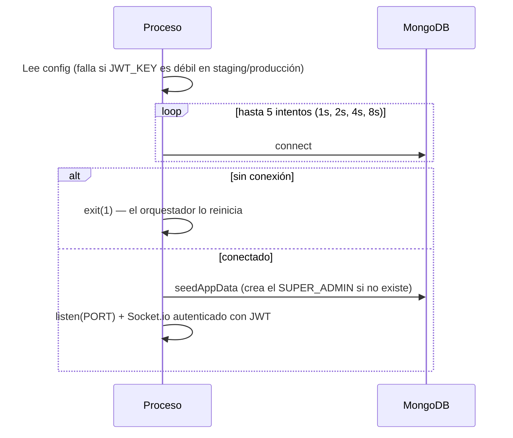
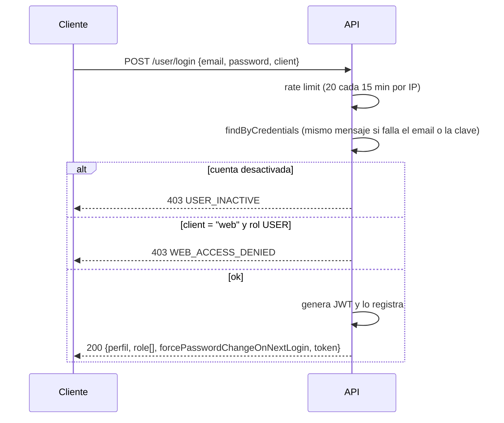
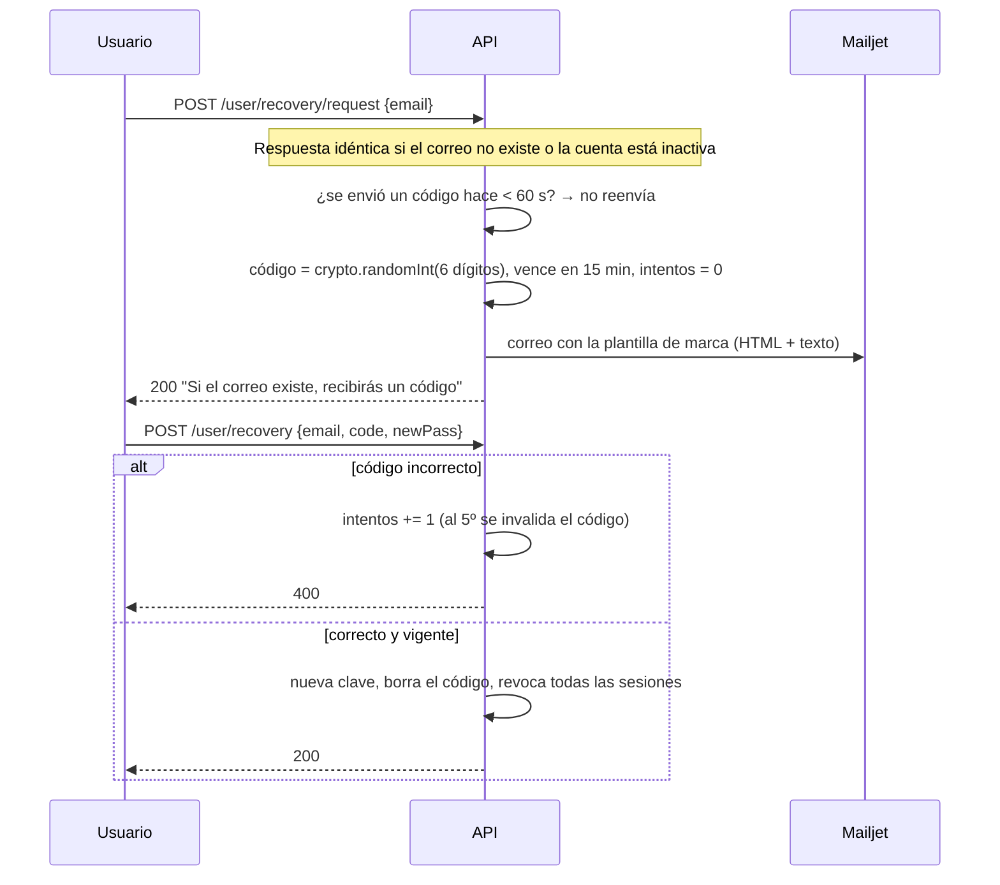
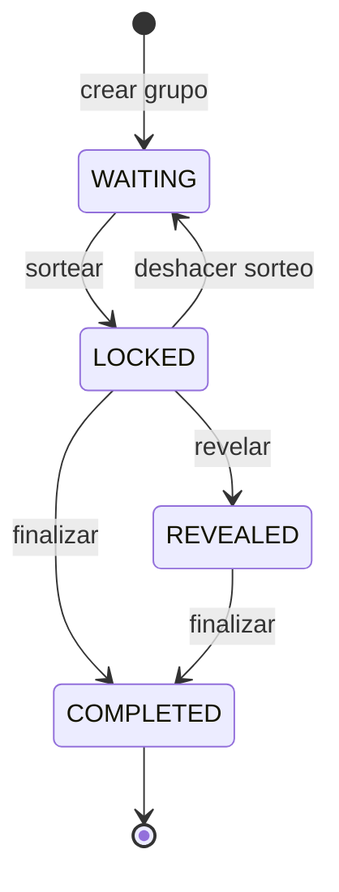
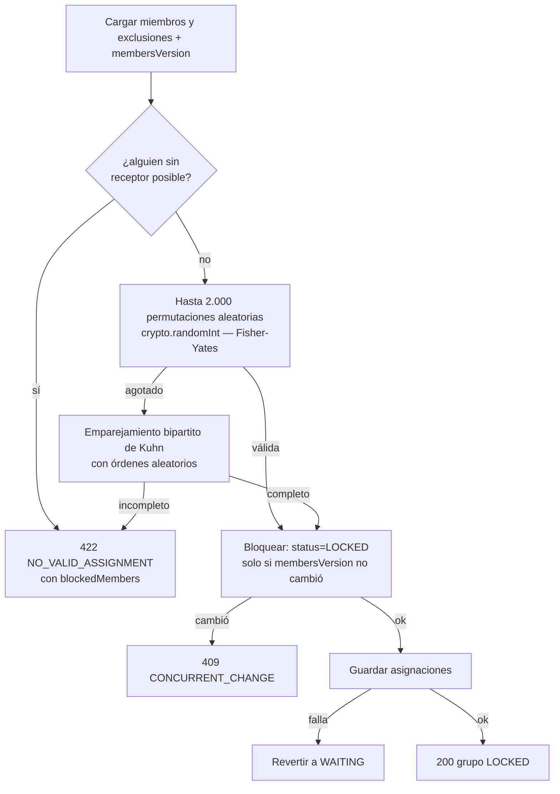
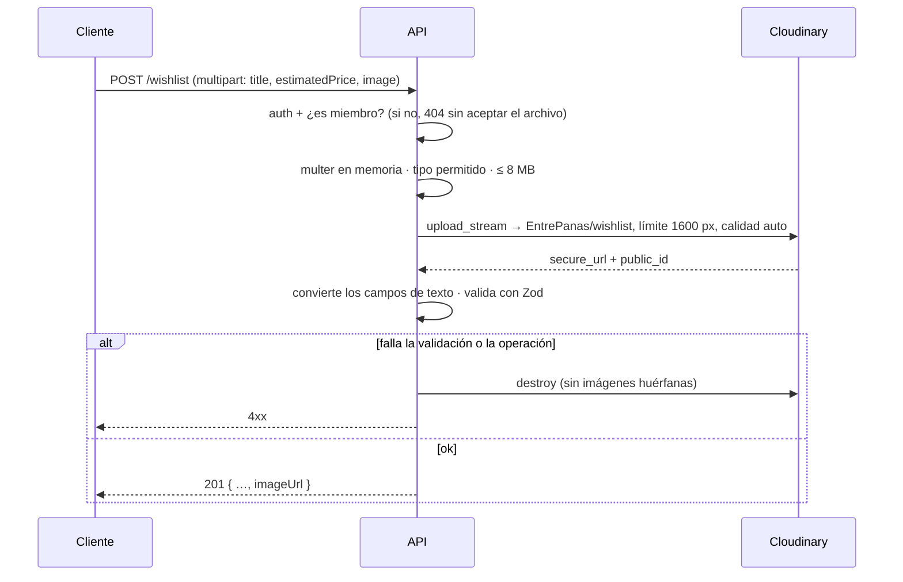
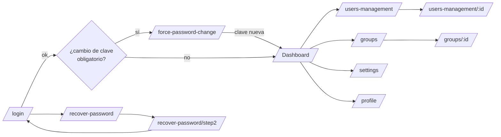

# EntrePanas — Qué está implementado y cómo funciona

> Estado al 21/10/2026. Este documento describe el sistema tal como está en el código. Los pendientes viven en [`REVISION.md`](./REVISION.md) y la referencia de endpoints en [`API_GRUPOS.md`](./API_GRUPOS.md).

## Índice

1. [Visión general](#1-visión-general)
2. [Arquitectura del monorepo](#2-arquitectura-del-monorepo)
3. [Backend: estructura y convenciones](#3-backend-estructura-y-convenciones)
4. [Flujos de autenticación y cuenta](#4-flujos-de-autenticación-y-cuenta)
5. [Roles y permisos](#5-roles-y-permisos)
6. [Gestión de usuarios (administración)](#6-gestión-de-usuarios-administración)
7. [Grupos de Amigo Secreto](#7-grupos-de-amigo-secreto)
8. [El sorteo](#8-el-sorteo)
9. [Sobres y revelación](#9-sobres-y-revelación)
10. [Lista de deseos](#10-lista-de-deseos)
11. [Configuración del sistema](#11-configuración-del-sistema)
12. [Estadísticas](#12-estadísticas)
13. [Correo transaccional (Mailjet)](#13-correo-transaccional-mailjet)
14. [Panel administrativo (web)](#14-panel-administrativo-web)
15. [App móvil (estado actual)](#15-app-móvil-estado-actual)
16. [Paquetes compartidos](#16-paquetes-compartidos)
17. [Seguridad aplicada](#17-seguridad-aplicada)
18. [Calidad: tests, tipos y lint](#18-calidad-tests-tipos-y-lint)
19. [Infraestructura y despliegue](#19-infraestructura-y-despliegue)
20. [Huecos conocidos](#20-huecos-conocidos)

---

## 1. Visión general

EntrePanas organiza intercambios de **Amigo Secreto**. Un usuario crea un grupo y comparte un código de invitación; sus panas se unen. El organizador define exclusiones (por ejemplo, que una pareja no se regale entre sí) y lanza el sorteo. Cada quien abre su "sobre" para saber a quién le regala y consulta la lista de deseos de esa persona. Al final el organizador revela todas las asignaciones y cierra el intercambio.

| Pieza | Para quién | Estado |
|---|---|---|
| **Backend** (API REST + WebSockets) | Todas las apps | Completo, salvo el chat |
| **Panel admin** (web) | SUPER_ADMIN, ADMIN, ORGANIZER | Completo |
| **App móvil** | Participantes (rol USER) | Maquetación, aún sin conexión a la API |

---

## 2. Arquitectura del monorepo



- **pnpm workspaces** (`apps/*`, `packages/*`) con `pnpm@11.4.0`.
- `shared` y `ui-tokens` se compilan en **doble formato**: `dist/cjs` para el backend (que usa `require`) y `dist/esm` para Vite y Metro, con `exports` condicionales.
- Cada app tiene su Dockerfile multi-stage; el contexto de build es la raíz, para resolver los paquetes compartidos.

---

## 3. Backend: estructura y convenciones

```
apps/backend/src/
├── app.ts            # crea la app Express (sin puertos ni BD) — la usan los tests
├── index.ts          # arranque: conecta Mongo, seed, HTTP + Socket.io
├── config/           # commons (variables de entorno), cors, db, roles, routes
├── middleware/       # auth, rateLimit, controllerError, saveFile (Cloudinary), seed
├── services/         # mail (Mailjet), mailTemplates
├── components/
│   ├── user/         # auth, perfil, recuperación, administración de usuarios
│   ├── config/       # configuración visual del sistema
│   ├── group/        # grupos, membresía, exclusiones, sorteo, sobres (+ draw.ts)
│   ├── wishlist/     # lista de deseos por grupo
│   └── stats/        # métricas del dashboard
├── routes/health.routes.ts
├── utils/            # http (sendOrError), authErrors, sanitizeEmail
└── test/             # helpers de tests de integración
```

**Patrón por componente:** `network.ts` (rutas Express) → `controller.ts` (validación, Zod en los módulos nuevos) → `store.ts` (lógica + Mongoose) → `model.ts`.

- El *store* nunca lanza al cliente: devuelve `{ status, message, detail? }`.
- `sendOrError` envía los 2xx y 4xx tal cual. Los 5xx se registran en el servidor y el cliente recibe `{ code: 'INTERNAL_ERROR', message }`.
- Formato de error estándar: `{ code: 'CODIGO', message: 'texto para el usuario' }`. La validación agrega `errors` por campo.
- Las rutas se montan en `/user`, `/config` y `/group`, y sus equivalentes `/api/...`. `GET /api/health` responde 200 con BD y **503** sin ella.
- Si al final ninguna ruta coincide, responde un 404 en JSON. Un manejador final captura JSON inválido (400), payload demasiado grande (413) y errores no controlados (500).

**Arranque (`index.ts`):**



---

## 4. Flujos de autenticación y cuenta

### 4.1 Sesiones

- **JWT** firmado con `JWT_KEY`, válido por 7 días. Payload: `{ _id, date }`.
- Cada token se guarda en `user.tokens[]`. El middleware `auth()` verifica la firma, que el token **siga registrado** en la BD y que el usuario esté activo. Así es posible revocar sesiones (logout, desactivación, cambio de clave).
- Al iniciar sesión se purgan del arreglo los tokens ya expirados.
- Socket.io usa la misma verificación en su handshake.

### 4.2 Registro (app móvil)

`POST /user/register` (límite de 10 por hora por IP) → crea un usuario con rol `USER` y responde con un token, así queda la sesión iniciada. Email único y validado; contraseña de al menos 6 caracteres, guardada con bcrypt (costo ≥ 10).

### 4.3 Inicio de sesión



En el panel: si `forcePasswordChangeOnNextLogin` es `true`, la ruta protegida redirige a **/force-password-change** y no deja usar nada más hasta completarlo.

### 4.4 Cambio de contraseña

| Caso | Endpoint | Reglas |
|---|---|---|
| Voluntario (perfil) | `POST /user/change-password` | Exige la clave actual; cierra **las demás** sesiones y conserva la actual |
| Obligatorio | `POST /user/change_password_required` | Solo si la cuenta tiene el flag; no pide la actual; quita el flag |
| Por un admin | `PATCH /user/admin/:id/password` | Activa el flag de cambio obligatorio y revoca **todas** las sesiones del usuario |
| Vía perfil | `PATCH /user/me` con `password` | **Rechazado** (400): solo se acepta por los endpoints anteriores |

### 4.5 Recuperación de contraseña



En desarrollo y tests la respuesta incluye `devCode`, para probar sin correo.

### 4.6 Perfil

- `GET /user/me` y `PATCH /user/me` (nombre, apellido, teléfono).
- `POST /user/upload` sube la foto a Cloudinary (`<FOLDER_NAME>/avatars`, máx. 8 MB, sin SVG) y borra la anterior después de guardar la nueva. La foto **solo** cambia así: `PATCH /user/me` ya no acepta URLs.
- `POST /user/logout` cierra la sesión actual; `POST /user/me/logoutall` cierra todas.

Las respuestas nunca incluyen `password`, `tokens` ni datos de recuperación.

---

## 5. Roles y permisos

Los roles se definen en un solo lugar, `packages/shared/src/roles.ts`, y los usan el backend y el panel.

| Rol | Panel web | Métricas y gestión | Puede asignar |
|---|---|---|---|
| `SUPER_ADMIN` | ✅ | ✅ todo | todos los roles |
| `ADMIN` | ✅ | ✅ (no puede tocar a SUPER_ADMIN) | ADMIN, ORGANIZER, USER |
| `ORGANIZER` | ✅ | ❌ (solo dashboard básico y perfil) | — |
| `USER` | ❌ (solo app) | — | — |

**Jerarquía (`canManageTarget`):** un ADMIN no puede editar, desactivar, resetear la clave ni forzar el cambio de un SUPER_ADMIN. Nadie puede desactivarse a sí mismo. Cambiar el rol de alguien es exclusivo de SUPER_ADMIN.

**Dentro de un grupo** hay roles aparte: `CREATOR` (el organizador del grupo) y `PARTICIPANT`. Son independientes del rol global: cualquier usuario puede crear grupos.

---

## 6. Gestión de usuarios (administración)

Endpoints en `/user/admin` (ADMIN o SUPER_ADMIN):

- **Listar** con búsqueda (nombre, apellido, email, teléfono; regex escapada), filtro por rol y por estado, y paginación (máx. 100).
- **Crear:** el rol se valida contra los que el actor puede asignar. El usuario nace con `forcePasswordChangeOnNextLogin = true` y recibe el correo «Se creó tu cuenta», que **nunca** incluye la contraseña.
- **Detalle**, **editar** datos básicos, **activar o desactivar** (desactivar revoca sus sesiones), **resetear la clave** (avisa por correo) y **forzar el cambio en el próximo inicio**.
- **Cambiar rol** (`PATCH /admin/:id/role`, solo SUPER_ADMIN):
  - Nadie puede cambiar su propio rol, así que siempre queda al menos un SUPER_ADMIN.
  - Al cambiar el rol se **cierran todas las sesiones** del usuario, que vuelve a entrar con los permisos nuevos.
  - **En el panel:** el modal de edición habilita el selector de rol solo para un SUPER_ADMIN y nunca sobre sí mismo, avisa que se cerrarán las sesiones, y los datos y el rol se guardan por endpoints separados.
- **Catálogo de roles:** `GET /user/roles`.

**Admin semilla:** al arrancar, si no existe `USER_ADMIN_EMAIL`, se crea como SUPER_ADMIN + ADMIN con cambio de clave obligatorio. En producción exige `USER_ADMIN_PASSWORD`; sin ella no se crea.

---

## 7. Grupos de Amigo Secreto

### 7.1 Modelo

- **Group:** nombre, descripción, emoji, creador, estado, fecha del intercambio, moneda (USD/VES), presupuesto mínimo/máximo (`null` = sin límite), cupo (3–50), pistas anónimas, código de invitación único, miembros `[{ user, role, joinedAt, exclusions[] }]`, `membersVersion` y las marcas `drawnAt`, `revealedAt` y `completedAt`.
- **Assignment** (colección aparte): `{ group, giver, receiver }` con índices únicos por grupo + giver y grupo + receiver. Las asignaciones **nunca** viajan con el grupo.

### 7.2 Ciclo de vida



| Estado | Permitido |
|---|---|
| **WAITING** (esperando panas) | Unirse, salir, expulsar, exclusiones, editar todo, regenerar código |
| **LOCKED** (sorteado) | Abrir el sobre propio, ver la lista de deseos del asignado, editar nombre/fecha/descripción, deshacer |
| **REVEALED** (revelado) | Todos los miembros ven la lista completa de asignaciones |
| **COMPLETED** (finalizado) | Solo lectura; la lista de deseos queda congelada |

### 7.3 Crear y unirse

```mermaid
sequenceDiagram
  participant O as Organizador
  participant API
  participant P as Pana
  O->>API: POST /api/group {name, exchangeDate, currency, budgetMin/Max, maxParticipants…}
  API->>API: Zod + fecha futura + min ≤ max
  API->>API: código PANA-XXXX-XX (crypto, sin O/0/I/1; reintenta si choca)
  API-->>O: 201 grupo (O queda como CREATOR)
  O-->>P: comparte el código (WhatsApp, etc.)
  P->>API: GET /api/group/code/:code (vista previa: nombre, organizador, cupo, canJoin)
  P->>API: POST /api/group/join {inviteCode}
  API->>API: actualización ATÓMICA: WAITING + no es miembro + miembros < cupo
  alt ok
    API-->>P: 201 grupo
  else ya era miembro
    API-->>P: 200 (idempotente)
  else lleno / sorteado / código inválido
    API-->>P: 409 GROUP_FULL / 409 GROUP_NOT_WAITING / 404 INVALID_INVITE_CODE
  end
```

Como la unión es atómica, si varios entran a la vez por el último cupo, entra uno solo (verificado en tests).

### 7.4 Gestión por el organizador

- **Editar** (`PATCH`): el estado no se cambia por aquí. Presupuesto, moneda y cupo solo se editan en WAITING, y el cupo nunca puede quedar por debajo de los miembros actuales.
- **Expulsar** a un miembro, y **salir** (participantes; el organizador no puede salir, puede eliminar el grupo). Ambas acciones borran las exclusiones que apuntaban a esa persona y su lista de deseos.
- **Exclusiones:** `PUT /:id/members/:userId/exclusions { exclusions, mutual }`. Por defecto son mutuas (A no le regala a B y B no le regala a A). La respuesta incluye `drawPossible`, que avisa **antes** de sortear si con esas reglas el sorteo es imposible.
- **Regenerar el código** (solo WAITING) y **eliminar el grupo**, que borra también las asignaciones, los deseos y sus imágenes (el organizador o un admin).
- **Invitar por correo** (`POST /:id/invitations`): hasta 20 correos por envío y 10 envíos por hora por organizador, con un mensaje personal opcional. Solo en WAITING y con cupo; omite a quienes ya son miembros y devuelve `{ sent, failed, invited, alreadyMembers }`.

### 7.5 Privacidad dentro del grupo

- Un no-miembro recibe **404** (no se revela que el grupo existe).
- Los participantes ven nombre, foto y rol de los demás. **Email y exclusiones** solo los ven el organizador y los administradores.
- **Mis grupos** (`GET /api/group?scope=all|created|joined`) devuelve un resumen por grupo: estado, fecha, presupuesto, cupo, miembros, mi rol, el organizador y `hasAssignment` (si ya tengo sobre).

---

## 8. El sorteo

`POST /api/group/:id/draw` (solo el organizador, en estado WAITING, mínimo 3 miembros).



- **Reglas garantizadas:** nadie se regala a sí mismo, cada quien da y recibe exactamente un regalo, y se respetan las exclusiones.
- **Justicia:** el muestreo por rechazo es uniforme entre todas las asignaciones válidas. Lo verifiqué con 4 personas: las 9 combinaciones posibles salen con la misma frecuencia.
- **Robustez:** con muchas exclusiones entra el algoritmo de Kuhn, que es polinomial y detecta cuándo es imposible. Probado con 50 personas y 25 parejas excluidas, y contrastado con fuerza bruta en miles de casos.
- **Deshacer** (`DELETE /:id/draw`, solo en LOCKED): vuelve a WAITING y borra las asignaciones. Sirve si alguien se suma tarde.

---

## 9. Sobres y revelación

- **Abrir mi sobre:** `GET /api/group/:id/assignment` devuelve **solo** a quién le regalo (nombre, apellido, foto; nunca el email). No existe ningún endpoint que diga quién me regala a mí.
- **Revelar** (`POST /:id/reveal`): desde ese momento `GET /:id/assignments` muestra la lista completa a todos los miembros. Antes de revelar responde 403 `NOT_REVEALED`, también para el organizador.
- **Finalizar** (`POST /:id/complete`): el grupo pasa a histórico.
- **El panel admin nunca muestra asignaciones**: solo miembros y exclusiones.

---

## 10. Lista de deseos

Base: `/api/group/:id/wishlist` (requiere ser miembro).

- **Mi lista** (`GET /me`), **agregar** (`POST /`), **editar** y **eliminar** deseos propios (`PATCH`/`DELETE /:wishId`).
- Cada deseo: título (2–120), descripción, precio estimado, moneda (por defecto la del grupo), URL del producto (solo http/https), **imagen** y favorito. Los favoritos se ordenan primero.
- Máximo **20 deseos** por persona y grupo.
- **Lista de mi amigo secreto** (`GET /assigned`): disponible desde el sorteo; muestra la lista de la persona a quien le regalo, con imágenes, nunca la de otros.
- Un deseo ajeno responde 404. En COMPLETED la lista es de solo lectura.

### Imagen del deseo (Cloudinary)



- **Reemplazar** (`PATCH` con `image`) o **quitar** (`removeImage: true`): la imagen anterior se borra de Cloudinary después de guardar el cambio.
- **Limpieza automática:** al eliminar el deseo, al salir o ser expulsado del grupo, o al eliminar el grupo, se borran también las imágenes.

---

## 11. Configuración del sistema

- `GET /api/config` (público) devuelve nombre de la app, colores primario/secundario/acento, logo y favicon. Si no existe, se crea con los valores por defecto de la marca.
- `PUT /api/config` (ADMIN) acepta multipart: valida los colores HEX y sube el logo y el favicon a Cloudinary.
- El panel aplica esta configuración en vivo: los colores pasan al tema de Ant Design, y el favicon y el título del documento se actualizan.

---

## 12. Estadísticas

`GET /api/stats` (ADMIN), calculado con agregaciones de Mongo:

- **Usuarios:** total, activos, inactivos, por rol y nuevos en 30 días.
- **Grupos:** total, nuevos en 30 días, por estado, participaciones totales y promedio por grupo.
- **Deseos:** total.
- **Actividad diaria** de los últimos 30 días (registros y grupos creados), agrupada en la zona `REPORT_TIMEZONE` (por defecto `America/Caracas`) y con los días vacíos rellenos.
- **Próximos intercambios:** los 6 más cercanos que no están finalizados.

---

## 13. Correo transaccional (Mailjet)

### Infraestructura
- `services/mail.ts` usa la API v3.1 de Mailjet con `fetch` (sin dependencias extra). `sendMail` envía un correo y `sendMailBatch` envía en **lotes de 50**, una llamada por lote. Nunca lanzan: registran el fallo y devuelven el resultado.
- **Transporte:** `mailjet` si hay claves; `log` en desarrollo y tests (lo guarda en memoria para verificarlo).
- **Remitente:** `entrepanas@erdesarrollo.com.ve` (dominio validado). Los enlaces usan `APP_PUBLIC_URL` (app) y `ADMIN_PUBLIC_URL` (panel).
- `services/notifications.ts` dispara los correos **en segundo plano**, así no retrasan la respuesta HTTP. Nunca escribe a cuentas desactivadas. Al apagar el servidor (SIGTERM), espera hasta 10 s a que terminen los envíos pendientes.
- `services/mailTemplates.ts`: diseño común (encabezado de marca, botón de acción, tabla de detalles con fecha y presupuesto en USD/Bs.) con versión HTML escapada y texto plano.

### Cuándo se envía cada correo

| Correo | Disparador | Destinatario |
|---|---|---|
| Bienvenida | Registro | El nuevo usuario |
| Cuenta creada | Un admin crea la cuenta | El usuario (sin la contraseña) |
| Código de recuperación | `POST /user/recovery/request` | El usuario |
| Contraseña cambiada | Cambio voluntario, obligatorio, por recuperación o reset del admin | El usuario (aviso de seguridad) |
| Invitación | `POST /group/:id/invitations` | Los correos indicados (con código y enlace `…/join/CÓDIGO`) |
| Bienvenida al grupo | Unirse (solo la primera vez) | El nuevo miembro |
| Nuevo miembro | Alguien se une | El organizador (avisa si el grupo quedó completo) |
| Sorteo realizado | `POST /draw` | Todos los miembros, **sin revelar asignaciones** |
| Sorteo reiniciado | `DELETE /draw` | Los miembros, excepto el organizador |
| Revelación | `POST /reveal` | Todos los miembros |
| Expulsión | El organizador expulsa a alguien | El expulsado |
| Grupo eliminado | `DELETE /group/:id` | Los miembros, excepto quien lo eliminó |

Envío real verificado: el correo de recuperación llegó a Gmail con estado `sent` en Mailjet.

---

## 14. Panel administrativo (web)

**Stack:** React 18, Vite 6, Ant Design 5, Tailwind 3, TanStack Query, React Router 7, i18next (es/en), Axios con interceptores.

**Sesión en el navegador:**
- El token y el usuario se guardan en `localStorage`.
- `ERDEAxios` agrega `Authorization` y `Accept-Language`. Ante un 401 limpia la sesión y redirige al login; ante 403 o 429 muestra un aviso.



**ProtectedRoute** exige token, un rol con acceso web y, si se pide, un rol concreto (SUPER_ADMIN pasa siempre). También aplica el cambio de contraseña obligatorio.

| Página | Qué hace |
|---|---|
| **Dashboard** | Para admins: KPIs (usuarios, grupos, participaciones, deseos) con variación de 30 días, gráfica de registros diarios con tooltip y vista de tabla, grupos por estado, usuarios por rol y próximos intercambios con enlace al detalle. Los organizadores ven una versión básica. |
| **Usuarios** | Tabla paginada con filtros dentro de las columnas (búsqueda, rol, estado), switch de activo, crear/editar en un modal y enlace al detalle. Al crear, el selector solo ofrece los roles asignables. Al editar, el rol solo lo cambia un SUPER_ADMIN (nunca el suyo propio), con aviso de que se cerrarán las sesiones. |
| **Detalle de usuario** | Datos, resetear clave (modal) y switch "exigir cambio en el próximo inicio". |
| **Grupos de Intercambio** | Tabla con búsqueda (nombre/código) y filtro por estado: organizador, cupo, fecha y presupuesto en USD/Bs. |
| **Detalle de grupo** | Ficha completa, miembros con email, rol, exclusiones y fecha de ingreso, eliminación con confirmación y aviso de privacidad. |
| **Configuración** | Nombre, colores, logo y favicon. |
| **Mi perfil** | Datos, avatar y cambio de contraseña. |
| **Recuperación** | Paso 1 (correo) y paso 2 (código + nueva clave). |

**Además:**
- La cabecera muestra el estado real de la API (en línea / sin BD / sin conexión) consultando `/api/health` cada minuto.
- Modo oscuro, selector de idioma y menú lateral plegable, filtrado por rol.
- Las gráficas usan un solo tono validado por contraste en ambos modos. Los estados de grupo siempre llevan icono y texto, nunca solo color.

---

## 15. App móvil (estado actual)

**Stack:** Expo SDK 57, React Native 0.86, React 19, `StyleSheet` nativo con estilos centralizados en `src/styles/`. Reglas en `AGENTS.md`: solo Expo Go, sin `expo export` y sin Tailwind.

Pantallas maquetadas, todas con datos simulados:
- **Login**, con un botón de Google sin implementar.
- **Registro.**
- **Recuperación** en 2 pasos con OTP de 6 dígitos.
- **Inicio** ("Mis Grupos": creados / participo, sobre por abrir, unirse con código) con barra flotante: grupos, papelitos, chat, mi pana.
- **Crear grupo** (presupuesto USD/Bs., presets, cupo, pistas anónimas) y un modal de éxito para compartir por WhatsApp.

Navegación: un historial de pantallas hecho a mano en `App.tsx`, con soporte del botón atrás de Android.

**Aún no consume la API.** El backend ya expone todo lo que estas pantallas necesitan; la conexión es la prioridad 4.

---

## 16. Paquetes compartidos

- **`@panasecreto/shared`:**
  - Enums: `GroupStatusEnum`, `MemberRoleEnum`, `CurrencyEnum` y los límites de participantes.
  - Roles: `ROLES`, `assignableRolesFor`, etc.
  - Esquemas Zod: `CreateGroupSchema`, `UpdateGroupSchema`, `JoinGroupSchema`, `SetExclusionsSchema`, `InviteByEmailSchema`, `CreateWishSchema`, `UpdateWishSchema` (con `removeImage`), `LoginSchema`, chat.
  - Tipos de respuesta: `GroupSummary`, `AssignmentView`, `Wish`…
  - El backend valida con estos mismos esquemas, y mobile podrá usarlos en sus formularios.
- **`@panasecreto/ui-tokens`:** paleta oficial de la identidad 2026 (Azul Marino `#0B2D5B`, Amarillo Pana `#FFC107`, Celeste Caribe `#00B4D8`, Coral `#FF5A3D`, Crema `#F8F7F2`), tipografía Fredoka + Nunito, espaciado y radios.

---

## 17. Seguridad aplicada

- **Secretos:** `JWT_KEY` obligatoria y fuerte en staging/producción (≥ 32 caracteres, distinta de los valores de ejemplo), sin valores por defecto en Docker. El admin semilla no tiene clave por defecto en producción.
- **Escalada de privilegios:** se valida el rol asignable y la jerarquía del usuario objetivo.
- **Contraseñas:** bcrypt con costo ≥ 10. Los cambios exigen la clave actual o un flujo autorizado, y revocan sesiones según el caso.
- **Fuerza bruta:** límites por IP en login, registro y recuperación; 5 intentos por cuenta para el código; 60 s entre reenvíos.
- **Enumeración:** misma respuesta para correos inexistentes; 404 para grupos y deseos ajenos.
- **Privacidad del sorteo:** colección aparte; ni el organizador ni el panel ven las asignaciones antes de revelar.
- **Entradas:** Zod estricto (rechaza campos extra), regex escapadas, IDs validados, URLs solo http/https.
- **Archivos:** multer en memoria con lista blanca de tipos (sin SVG), máximo 8 MB y 3 archivos. Se sube con el SDK oficial de Cloudinary v2 a carpetas por tipo. La membresía se valida antes de aceptar archivos, no quedan imágenes huérfanas y solo se borran imágenes de la propia cuenta.
- **Correos:** nunca llevan contraseñas ni revelan asignaciones; las invitaciones tienen límite por organizador.
- **Errores:** sin detalles internos hacia el cliente.
- **HTTP:** Helmet, CORS por lista de dominios (o `*` sin credenciales), `trust proxy` para que los límites vean la IP real.
- **Nginx:** CSP, `X-Frame-Options`, `nosniff`, `Referrer-Policy`, `Permissions-Policy`.

---

## 18. Calidad: tests, tipos y lint

| Comando | Qué cubre |
|---|---|
| `pnpm test` | **103 tests** de integración (Node test runner + `mongodb-memory-server`, con Mailjet y Cloudinary simulados): autenticación, roles y cambio de rol, recuperación, grupos (permisos, privacidad, cupo con concurrencia, estados), sorteo (contra fuerza bruta y uniformidad), lista de deseos e imágenes (subida, reemplazo, huérfanas, cascadas), estadísticas y los 12 correos (destinatarios, privacidad, cuentas inactivas). |
| `pnpm typecheck` | TypeScript estricto en los 5 paquetes. |
| `pnpm lint` | ESLint 10 + typescript-eslint + React Hooks: **0 errores, 0 advertencias** (`--max-warnings 0`). `any` está prohibido (`no-explicit-any: error`): se usa `unknown` con validación o tipos concretos (`FilterQuery`, `ColumnsType`, `LucideIcon`…). |

---

## 19. Infraestructura y despliegue

- **Docker Compose local:** Mongo 7 (solo en `127.0.0.1`), backend en `:4000` y admin en `:8080`. Los secretos vienen de `.env` (ver `.env.example`).
- **Coolify:**
  - Backend: Dockerfile `apps/backend/Dockerfile`, puerto 4000, healthcheck `/api/health`, usuario no-root.
  - Admin: Dockerfile `apps/admin/Dockerfile`, Nginx en el puerto 80. La Build Variable `VITE_API_URL` debe apuntar a la API pública.
- **Variables del backend:** documentadas en el README (Mongo, JWT, admin semilla, CORS, Mailjet, URLs públicas, Cloudinary, bcrypt, zona horaria).
- **Dependencias:** se eliminó `multer-storage-cloudinary`, que pedía cloudinary v1; la subida ahora usa directamente el SDK v2. Mobile tiene su propio `react-dom` 19.2.3, que resuelve el conflicto con el `react-dom` 18 del admin.

---

## 20. Huecos conocidos

| Tema | Detalle |
|---|---|
| Chat anónimo | El archivo existe (`sockets/chat.socket.ts`), pero no está conectado ni valida membresía. Se hará con la app. |
| App móvil | Maqueta sin API. Su "usuario" (username) del registro no existe en el backend; su fecha del grupo es texto y la API espera ISO. |
| Recordatorios por correo | Faltan los avisos programados (por ejemplo, "faltan 3 días para el intercambio"); requieren una tarea programada (cron). |
| Vulnerabilidades sin parche | `node-forge`, `braces` y `uuid` vienen de herramientas de mobile (Expo CLI / Metro), no del backend ni del admin. No hay versión corregida publicada todavía. |
| Mongo local | Sin usuario/contraseña en `docker-compose` (solo apto para desarrollo). |

